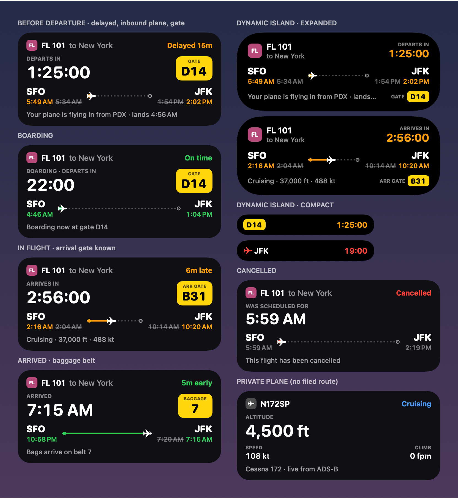
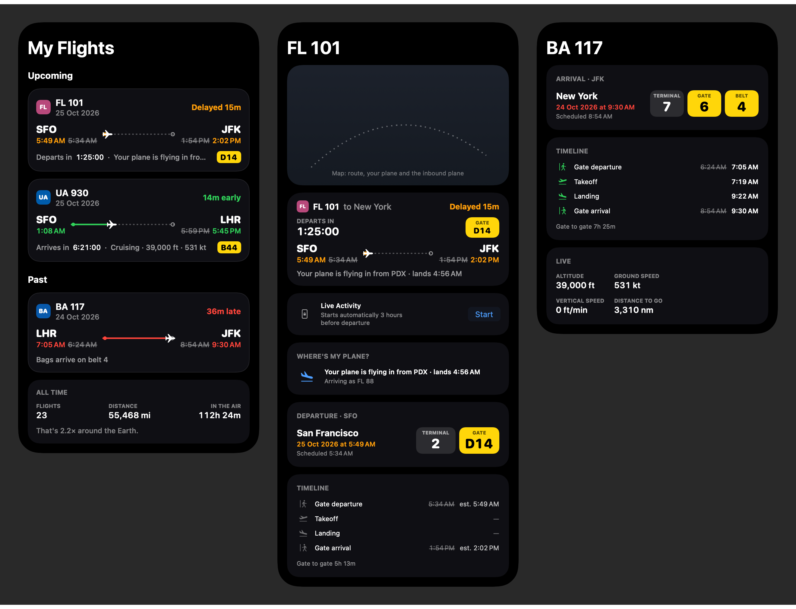

<!-- datasheet:banner -->

  <picture>
    <source media="(prefers-color-scheme: dark)" srcset=".github/assets/banner-dark.svg">
    
  </picture>

<!-- /datasheet:banner -->

# FlightLive

**A flight tracker for iPhone with a Flighty-style Live Activity: the countdown on your Lock Screen, the gate in your Dynamic Island, and the plane you are waiting for on a map.**

It tracks real flights from live positions, schedules and gates, warns you about gate changes and delays, and keeps your trips together. Add flights by searching, by sharing a booking email, from your calendar, from Notion or from a boarding pass.

<!-- datasheet:figure -->
## At a glance

  <picture>
    <source media="(prefers-color-scheme: dark)" srcset=".github/assets/diagram-dark.svg">
    
  </picture>

| Characteristic | Detail |
| --- | --- |
| **Platform** | iOS 17+ (Xcode 16 or newer to build); runs in the simulator with a 5-minute demo flight |
| **Live Activity** | Countdown, gate chip, route bar and context line on the Lock Screen; gate and countdown in the Dynamic Island |
| **Data** | Free without a key: live positions from adsb.lol, routes from adsbdb.com. Optional AeroDataBox key adds schedules, gates and delays |
| **Detection** | Pushback, takeoff, landing and gate arrival are detected from live positions; over oceans position is estimated |
| **Add flights** | Search, share a booking email or text, pick up calendar events, import from Notion or a Flighty CSV, or scan a boarding pass barcode |
| **Beyond the app** | Home Screen and Lock Screen widget, Siri, Shortcuts and the Action button, Spotlight, iCloud calendar sync, CSV export |
| **Limits** | iOS decides background refresh, usually 15 minutes or more; countdowns keep ticking regardless |
<!-- /datasheet:figure -->

## Quick start

1. Open `FlightLive.xcodeproj` in Xcode 16 or newer.
2. Pick an iPhone simulator with a Dynamic Island (any "Pro" model) and press **Run** (⌘R).
3. Tap **Watch a 5-minute demo flight**, then lock the simulator (⌘L) for the Lock Screen or go Home (⇧⌘H) for the Dynamic Island.

## Features

**Live Activity**
- Top row: airline badge, flight number and your seat. Under each time, the terminal and how late or early it is ("T2 · 10m late", "5m early · T4").
- A live headline that keeps ticking: "Departs gate in", then "Arrives at gate in", then "At the gate in", with a line of context under it and the gate on the right as a yellow chip with a walking figure (a suitcase for the baggage belt).
- A yellow chip for the departure gate, then the arrival gate, then the baggage belt.
- Each airport's times shown in its local time zone. Times are colored by delay: green on time or early, amber up to 30 minutes late, red beyond that.
- A route bar with the plane's position.
- A context line that changes with each stage: where your plane is coming from, boarding, taxiing, altitude and speed, landed, bags on belt 7.
- Dynamic Island: a status dot and the countdown on the left and the gate chip on the right when compact; a progress ring when minimal; when expanded, your seat, the route with status under each time, and the countdown with "until gate arrival". If the plane's position is only estimated, the expanded view says so.
- Starts automatically three hours before departure, or right away from the flight screen. It lights up with a sound for gate changes, delays, boarding, takeoff, landing and the baggage belt.
- Xcode previews of the Lock Screen card and the three island sizes cover every stage: scheduled, delayed, boarding, taxiing, cruising, descending, arrived, cancelled and diverted.

**App**
- **My Flights:** upcoming and past flights, plus all-time stats (flights, miles, hours in the air).
- **Search:** by flight number and date, or by tail number for private planes.
- **Flight screen:**
  - A map with the route, your plane and the inbound plane
  - The Live Activity card
  - Departure and arrival with terminal, gate and belt
  - A timeline: gate departure, takeoff, landing and gate arrival, scheduled vs. actual
  - Live altitude, speed and distance remaining
  - Aircraft type and registration
  - Sharing the flight's status as text
- **Where's my plane?** Before departure, it finds the aircraft assigned to your flight and shows where it's flying in from and when it lands.
- **Detected from live positions:** pushback, takeoff, landing and arrival at the gate. Over oceans, where coverage drops out, position is estimated from the schedule.
- **Notifications:** gate assigned or changed, delays of 15 minutes or more, boarding, takeoff, landing, arrival gate and baggage belt.
- **Settings:** aviation, imperial or metric units.
- **Demo flight:** five minutes covering every stage, with a delay, a gate change and the inbound plane.

**More ways to add a flight**
- **Share Sheet:** share a booking email, an airport text message, a note or a link from another app to FlightLive and it becomes a new flight, or an update to one you already have. There is also an *Add or Update Flight from Text* action for Shortcuts, so a shortcut or a Messages automation can add flights from airport texts.
- **Calendar:** flights that Gmail or Apple Mail put in your calendar from a booking email are picked up.
- **Notion:** connect a Notion database of flights (an integration secret and the database) and import them.
- **Flighty export:** read a Flighty CSV, or a calendar event, to bring in flights you have already taken.
- **Boarding pass:** add one from Photos or Files. FlightLive reads the barcode (the IATA BCBP format used by nearly every airline), shows the seat and booking code, and shows the pass full screen at full brightness for the gate scanner. Tapping the Live Activity can open it.
- **By hand:** enter times, the gate and when boarding starts, for example from your boarding pass.
- **Suggestions as you type:** airports and airlines are recognised by city, name or code ("Bengaluru" or "BLR").

**Around the flight**
- **Weather at the destination** for the time you land, from Open-Meteo.
- **Weather radar:** a map on the flight screen with the route (flown part solid, the rest dotted), the two airports as pills, the plane turned to its track, and the last two hours of precipitation radar looping over it. Tap it for full screen, where you can move and zoom. Play and pause it, and it says how old each picture is. If the radar can't be reached it is taken off the map and says so. Radar is only fetched while the map is on screen, and the frames list is read once each time you open the flight.
- **A photo of the plane** from Wikimedia Commons, with the photographer's credit: the exact aircraft by its tail number (found by file name, or in the plane's own Commons category), or else its type from the Wikipedia article (found by title, or by Wikipedia's search for unusual spellings). If a photo can't be loaded right now, it is tried again shortly. If none is found, nothing is shown.
- **Connections:** the time between landing and the next take-off from the same airport, on My Flights and on the flight screen. The flight screen also rates it (Risky, Minimum or Normal) on a gauge and lists what the connection involves: passport control, collecting and re-checking bags, a train or shuttle between terminals, security, the walk to the gate and the gate closing. Every time there is an estimate from typical times at large airports, not from the airport or the airline, and the card says so. Which checkpoints apply comes from the countries of the airports, the terminals and whether your bags are checked through; you can change the bags and the international choices on the card. A connection under an hour is never rated Normal.
- **When to leave:** a timeline on the flight screen. Leave from where you are (with the street name), the drive time from Apple Maps with traffic, and "Up by 15m" in red when traffic has made it longer than the first estimate. Then when to arrive at the airport and at which terminal, and the time you want to have there. That time is set in Settings: 90 minutes for a domestic flight and 3 hours for an international one. A flight counts as international when the two airports are in different countries; if an airport's country isn't known, it is treated as domestic and says so. Without location access the card says so and offers to turn it on, and until then uses a set time before departure. The Lock Screen's "Leave by" line and the reminder use the same time. Your location is asked for only while a leave time is being worked out. If you choose, tapping *Go* also starts your Apple Music (what you were listening to, or a playlist).
- **Passport:** a map of every route you have flown, shareable stats cards (all time, or one year) and every past flight.
- **Delays:** live and past delays, cancellations and diversions across your flights, with on-time, average and worst delay tallies by airline and airport.

**Everywhere you are**
- **Widget:** your next flight, or the one you are on, on the Home Screen and the Lock Screen.
- **Siri, Shortcuts and the Action button:** *Flight Status*, *Where's My Plane?*, *Get Flight Arrival Time*, *Show Flight on Lock Screen*, *Track a Flight*, *Search for a Flight* and *Update Flights*. Phrases such as "Where's my plane in FlightLive" work as soon as the app is installed.
- **Spotlight:** type "6E 978" or a city and the flight comes up.
- **iCloud calendar:** every flight is kept in a "FlightLive" calendar in your iCloud account, so a new iPhone or a reinstall gets them back, and they show in Calendar on your Mac and iPad.
- **Export:** every flight as a CSV in Flighty's layout, which opens in Numbers or Excel and comes back in with *Import from Flighty*.

## Run it on your iPhone

You need Xcode 16 or newer (free on the Mac App Store). The app runs on iOS 17+ (iPhone only).

- Open **Signing & Capabilities** for all three targets, `FlightLive`, `FlightLiveWidget` and `FlightLiveShare`, and pick your Apple ID team.
- If Xcode says the bundle identifier is taken, change its prefix to something of your own in all three targets (the app, the widget and the share extension each have one).

## Schedules, gates and delays (optional, free key)

- **Free without a key:** live positions from [adsb.lol](https://adsb.lol) and routes from [adsbdb.com](https://www.adsbdb.com) work as-is. You can track any plane that's in the air right now.
- **With a key:** you also get future flights, gates, terminals, baggage belts, delays, cancellations and the inbound plane. These come from [AeroDataBox](https://aerodatabox.com).
- **Getting the key:** sign up for a free plan on [RapidAPI](https://rapid.aerodatabox.com/pricing) or [API.Market](https://apimarket.aerodatabox.com/). Paste the key in **Settings** in the app; it's stored in the iOS Keychain.
- **Free-tier usage:** to stay within the free tier, the app checks the schedule every 15 minutes in the last three hours before departure, every 30 minutes in the air, and less often further out. Live positions update every 15 seconds while the app is open.

## Typical application

* **Before the trip:** share the booking email to FlightLive, add the boarding pass from Photos, and check *Getting to the airport* for when to set off.
* **At the airport:** the Live Activity shows the gate, and the boarding pass is one tap away at full brightness.
* **In the air:** the countdown ticks on the Lock Screen, and "Where's my plane in FlightLive" works from Siri.
* **Afterwards:** the flight lands in your Passport, and the Flighty-layout CSV keeps your history portable.

## Absolute maximum ratings

| Parameter | Limit |
|---|---|
| Platform | iOS 17 or newer, iPhone only (no Mac Catalyst) |
| Build | Xcode 16 or newer |
| Live Activity start | three hours before departure, or right away from the flight screen |
| Delay colours | green on time or early, amber up to 30 minutes late, red beyond that |
| Schedule checks (with a key) | every 15 minutes in the last three hours before departure, every 30 minutes in the air, less often further out |
| Background refresh while closed | decided by iOS, usually every 15 minutes or more |
| "Boarding" when the airline gives no time | assumed 35 minutes before departure |
| Cost | Xcode and an Apple ID; the schedule API has a free tier |
| Flights found without a key | any plane in the air right now |

## Errata

- **Background updates:** while the app is closed, iOS decides when it may refresh, usually every 15 minutes or more. The countdowns keep ticking regardless. Flighty refreshes constantly through its own servers and push notifications. Doing the same here would need a server and a paid Apple Developer account.
- **Coverage:** ADS-B coverage is thin over oceans. The app switches to an estimated position and says so.
- **"Boarding":** comes from the airline when AeroDataBox has it. Otherwise it's assumed to start 35 minutes before departure.
- **Radar:** RainViewer's free service is for personal and educational use, shows only the last two hours (no forecast) and only zooms in to level 7 (the map stretches that picture beyond). It allows 100 requests per address per minute, so the app loads the radar slowly and keeps what it has. It makes no promise that radar will be available. If you ever distribute FlightLive beyond personal use, you would need RainViewer's commercial terms.

## Files

| Path | What's in it |
| --- | --- |
| `Shared/FlightActivityAttributes.swift` | Data model shared by the app and the widget: flight, times, gates, phases, units |
| `Shared/FlightPresentation.swift` | What to show at each stage: status, countdown, gate chip, context line |
| `Shared/FlightViews.swift` | Lock Screen card, route row with status under each time, gate chip, seat tag, airline badge, route bar |
| `Shared/FlightSamples.swift` | Sample flights for previews |
| `Widget/FlightLiveActivity.swift` | Live Activity and Dynamic Island, with Xcode previews for every stage |
| `App/FlightAPI.swift` | AeroDataBox, adsb.lol and adsbdb.com clients; flight search |
| `App/FlightMath.swift` | Merges schedule and live data, detects stages, finds the inbound plane, runs the demo |
| `App/FlightStore.swift` | My Flights storage, refresh schedule, Live Activities, background refresh |
| `App/FlightEvents.swift` | Change detection for alerts and notifications |
| `App/AppSettings.swift` | Settings, with the API key in the Keychain |
| `App/FlightsListView.swift`, `AddFlightView.swift`, `FlightDetailView.swift`, `EditFlightDetailsView.swift`, `SettingsView.swift` | Screens |
| `App/FlightTextImport.swift`, `FlightTextParser.swift`, `ShareExtension/ShareViewController.swift` | Turns shared or pasted text into a flight; the Share Sheet entry |
| `App/CalendarImport.swift`, `CalendarSync.swift` | Flights found in calendar events; the iCloud "FlightLive" calendar |
| `App/NotionImport.swift`, `NotionSettingsView.swift` | Notion database of flights |
| `App/PastFlightImport.swift`, `FlightExport.swift` | Flighty CSV and calendar import for past flights; CSV export |
| `App/BoardingPass.swift`, `BoardingPassViews.swift` | Barcode (BCBP) reading; the boarding pass screens |
| `App/Passport.swift`, `PassportView.swift`, `DelaysView.swift` | Totals, route map, shareable cards and the delays report |
| `App/Connections.swift`, `GettingThere.swift`, `ArrivalWeather.swift`, `AircraftPhotos.swift`, `RouteSearch.swift` | Connections, drive time, arrival weather, plane photos, airport and airline suggestions |
| `App/WhenToLeave.swift`, `AirportCountries.swift` | The When to Leave timeline and the time at the airport; which country each airport is in |
| `App/ConnectionAssistant.swift` | The connection gauge and checklist, and the table of typical times behind them |
| `App/WeatherRadar.swift` | The weather radar map, its frames, and the tile loader that keeps to RainViewer's request limit |
| `App/FlightIntents.swift`, `SpotlightIndex.swift` | Siri, Shortcuts, Action button and Spotlight |
| `App/WidgetSync.swift`, `App/WatchSync.swift`, `Shared/WidgetSnapshot.swift`, `Shared/NextFlightWidgetViews.swift`, `Widget/NextFlightWidget.swift` | The Home Screen and Lock Screen widget, the Apple Watch snapshot sender and the data they read |

Live position data © adsb.lol contributors, ODbL. Weather from [Open-Meteo](https://open-meteo.com). Plane photos from Wikimedia Commons, shown with their credit and licence. Airport countries from [OurAirports](https://ourairports.com/data/), public domain. Weather radar by [RainViewer](https://www.rainviewer.com/), used under its free terms for personal and educational use.

## License

MIT. See [LICENSE](LICENSE).

<!-- datasheet:footer -->
---

  <a href="https://github.com/S-k404/aether-7">&larr; U10 aether-7</a> &middot;
  <a href="https://github.com/S-k404/S-k404">SK-404 index</a> &middot;
  <a href="https://github.com/S-k404/study-copilot">U12 study-copilot &rarr;</a>

<!-- /datasheet:footer -->
