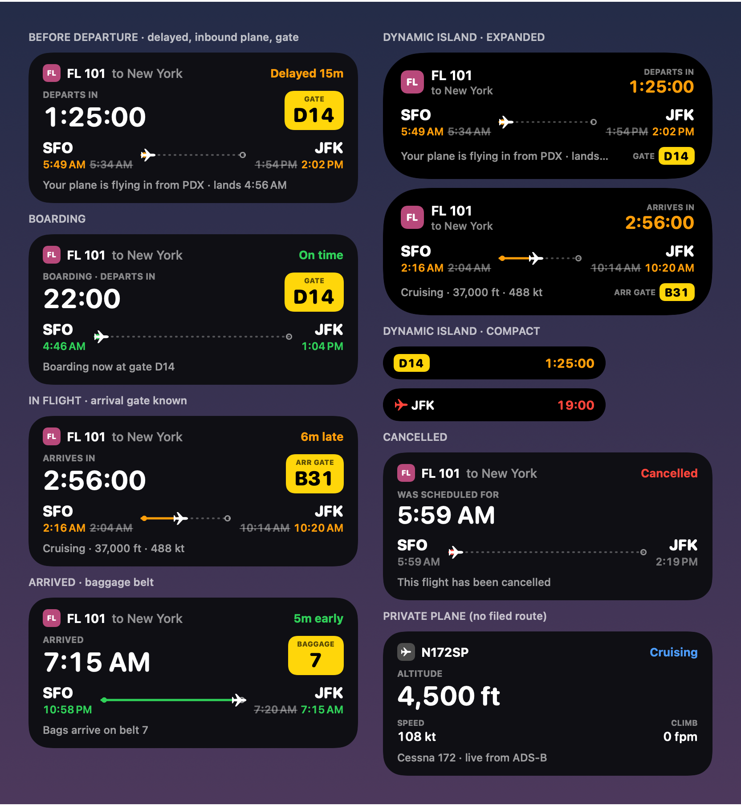
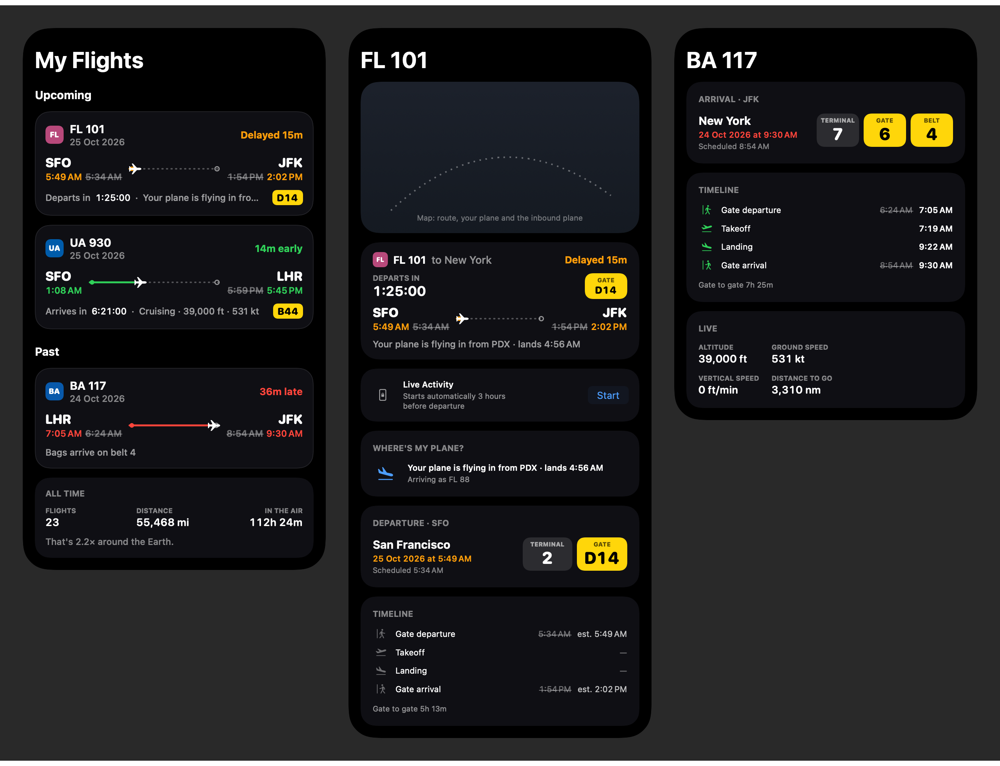

<!-- datasheet:banner -->

  <picture>
    <source media="(prefers-color-scheme: dark)" srcset=".github/assets/banner-dark.svg">
    
  </picture>

<!-- /datasheet:banner -->

# FlightLive

A flight tracker for iPhone with a Flighty-style Live Activity on the Lock Screen and in the Dynamic Island.

<!-- datasheet:figure -->
## At a glance

  <picture>
    <source media="(prefers-color-scheme: dark)" srcset=".github/assets/diagram-dark.svg">
    
  </picture>

| Characteristic | Detail |
| --- | --- |
| **Platform** | iOS 17+ (Xcode 16 or newer to build); runs in the simulator with a 5-minute demo flight |
| **Live Activity** | Countdown, gate chip, route bar and context line on the Lock Screen; gate and countdown in the Dynamic Island |
| **Data** | Free without a key: live positions from adsb.lol, routes from adsbdb.com. Optional AeroDataBox key adds schedules, gates and delays |
| **Detection** | Pushback, takeoff, landing and gate arrival are detected from live positions; over oceans position is estimated |
| **Limits** | iOS decides background refresh, usually 15 minutes or more; countdowns keep ticking regardless |
<!-- /datasheet:figure -->

## Features

**Live Activity**
- A big live countdown: "Departs in", then "Arrives in", then "At the gate in". It keeps ticking between updates.
- A yellow chip for the departure gate, then the arrival gate, then the baggage belt.
- Each airport's times shown in its local time zone. Times are colored by delay: green on time or early, amber up to 30 minutes late, red beyond that. When a time changes, the original is struck through.
- A route bar with the plane's position.
- A context line that changes with each stage: where your plane is coming from, boarding, taxiing, altitude and speed, landed, bags on belt 7.
- Dynamic Island: gate and countdown in the compact view, a progress ring in the minimal view, and the full card when expanded.
- Starts automatically three hours before departure, or right away from the flight screen. It lights up with a sound for gate changes, delays, boarding, takeoff, landing and the baggage belt.

**App**
- **My Flights:** upcoming and past flights, plus all-time stats (flights, miles, hours in the air).
- **Search:** by flight number and date, or by tail number for private planes.
- **Flight screen:**
  - A map with the route, your plane and the inbound plane
  - The Live Activity card
  - Departure and arrival with terminal, gate and belt
  - A timeline: gate departure, takeoff, landing and gate arrival, scheduled vs. actual
  - Live altitude, speed and distance remaining
  - Aircraft type and registration
  - Sharing the flight's status as text
- **Where's my plane?** Before departure, it finds the aircraft assigned to your flight and shows where it's flying in from and when it lands.
- **Detected from live positions:** pushback, takeoff, landing and arrival at the gate. Over oceans, where coverage drops out, position is estimated from the schedule.
- **Notifications:** gate assigned or changed, delays of 15 minutes or more, boarding, takeoff, landing, arrival gate and baggage belt.
- **Settings:** aviation, imperial or metric units.
- **Demo flight:** five minutes covering every stage, with a delay, a gate change and the inbound plane.

## Run it

You need Xcode 16 or newer (free on the Mac App Store). The app runs on iOS 17+.

1. Open `FlightLive.xcodeproj`.
2. Pick an iPhone simulator with a Dynamic Island (any "Pro" model) and press **Run** (⌘R).
3. Tap **Watch a 5-minute demo flight**. Lock the simulator (⌘L) to see the Lock Screen, or go Home (⇧⌘H) to see the Dynamic Island.

To run it on your own iPhone:
- Open **Signing & Capabilities** for both the `FlightLive` and `FlightLiveWidget` targets and pick your Apple ID team.
- If Xcode says the bundle identifier is taken, change `com.shamit` to something else in both targets.

## Schedules, gates and delays (optional, free key)

- **Free without a key:** live positions from [adsb.lol](https://adsb.lol) and routes from [adsbdb.com](https://www.adsbdb.com) work as-is. You can track any plane that's in the air right now.
- **With a key:** you also get future flights, gates, terminals, baggage belts, delays, cancellations and the inbound plane. These come from [AeroDataBox](https://aerodatabox.com).
- **Getting the key:** sign up for a free plan on [RapidAPI](https://rapid.aerodatabox.com/pricing) or [API.Market](https://apimarket.aerodatabox.com/). Paste the key in **Settings** in the app; it's stored in the iOS Keychain.
- **Free-tier usage:** to stay within the free tier, the app checks the schedule every 15 minutes in the last three hours before departure, every 30 minutes in the air, and less often further out. Live positions update every 15 seconds while the app is open.

## Limits

- **Background updates:** while the app is closed, iOS decides when it may refresh, usually every 15 minutes or more. The countdowns keep ticking regardless. Flighty refreshes constantly through its own servers and push notifications. Doing the same here would need a server and a paid Apple Developer account.
- **Coverage:** ADS-B coverage is thin over oceans. The app switches to an estimated position and says so.
- **"Boarding":** comes from the airline when AeroDataBox has it. Otherwise it's assumed to start 35 minutes before departure.

## Files

| Path | What's in it |
| --- | --- |
| `Shared/FlightActivityAttributes.swift` | Data model shared by the app and the widget: flight, times, gates, phases, units |
| `Shared/FlightPresentation.swift` | What to show at each stage: status, countdown, gate chip, context line |
| `Shared/FlightViews.swift` | Lock Screen card, gate chip, airline badge, route bar |
| `Shared/FlightSamples.swift` | Sample flights for previews |
| `Widget/FlightLiveActivity.swift` | Live Activity and Dynamic Island, with Xcode previews |
| `App/FlightAPI.swift` | AeroDataBox, adsb.lol and adsbdb.com clients; flight search |
| `App/FlightMath.swift` | Merges schedule and live data, detects stages, finds the inbound plane, runs the demo |
| `App/FlightStore.swift` | My Flights storage, refresh schedule, Live Activities, background refresh |
| `App/FlightEvents.swift` | Change detection for alerts and notifications |
| `App/AppSettings.swift` | Settings, with the API key in the Keychain |
| `App/FlightsListView.swift`, `AddFlightView.swift`, `FlightDetailView.swift`, `SettingsView.swift` | Screens |

Live position data © adsb.lol contributors, ODbL.

## License

MIT. See [LICENSE](LICENSE).
